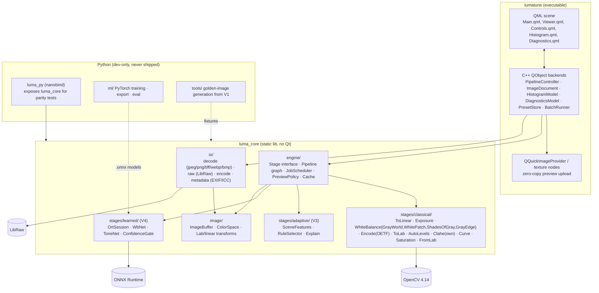

# LumaTune — Engineering Plan

**Status:** Draft v1 · **Date:** 2026-10-22 · **Owner:** @AblazedTC
**Scope:** Rewrite the Python/PySide6 V1 app as a native C++ / Qt Quick executable, then deliver V2 (RAW + linear), V3 (adaptive selection), and V4 (learned white balance + tone mapping).

> Companion documents: [README.md](./README.md) (user-facing V1 docs), [AGENTS.md](./AGENTS.md) (build guide and conventions for contributors and coding agents).
> Facts about third-party versions and licenses below were verified against official sources on 2026-10-22; items marked ⚠️ could not be fully verified and must be re-checked before relying on them.

---

## Table of contents

0. [How to read this plan](#0-how-to-read-this-plan)
1. [Vision, goals, non-goals](#1-vision-goals-non-goals)
2. [Where we are: V1 (Python) audit](#2-where-we-are-v1-python-audit)
3. [Language and runtime decision](#3-language-and-runtime-decision)
4. [Target architecture](#4-target-architecture)
5. [Repository layout](#5-repository-layout)
6. [Core data model and contracts](#6-core-data-model-and-contracts)
7. [Pipeline engine design](#7-pipeline-engine-design)
8. [UI design (Qt Quick)](#8-ui-design-qt-quick)
9. [GPU strategy](#9-gpu-strategy)
10. [Build system, dependencies, toolchains](#10-build-system-dependencies-toolchains)
11. [Testing strategy](#11-testing-strategy)
12. [Packaging and distribution](#12-packaging-and-distribution)
13. [Licensing](#13-licensing)
14. [Delivery phases and task breakdown](#14-delivery-phases-and-task-breakdown)
15. [V2 — RAW and linear pipeline](#15-v2--raw-and-linear-pipeline)
16. [V3 — Adaptive algorithm selection](#16-v3--adaptive-algorithm-selection)
17. [V4 — Learned white balance and tone mapping (full plan)](#17-v4--learned-white-balance-and-tone-mapping-full-plan)
18. [Cross-cutting concerns](#18-cross-cutting-concerns)
19. [CI/CD](#19-cicd)
20. [Risk register](#20-risk-register)
21. [Open questions](#21-open-questions)
22. [Glossary](#22-glossary)

---

## 0. How to read this plan

- **Requirement IDs** — `FR-x` functional, `NFR-x` non-functional, `T-x` testing, `V2/V3/V4-x` version-specific. Tasks reference them so every task is traceable to a requirement.
- **Task IDs** — `P<phase>.<n>` (e.g. `P1.4`). Each task lists: deliverable, acceptance criteria, size (S ≤ 1 day, M ≤ 3 days, L ≤ 1 week, XL > 1 week for one engineer working with coding agents), and dependencies.
- **Exit gates** — Each phase ends with a gate that must be green before the next phase starts. Gates are objective (tests, benchmarks, checklists), not opinions.
- **Decision records** — Marked `DR-n`. When a DR is revisited, add a new DR rather than editing the old one.

---

## 1. Vision, goals, non-goals

### 1.1 Vision

A fast, explainable, native desktop photo enhancer. Open a JPEG/PNG/RAW, get a well-exposed, well-balanced result in under a second, see exactly what the algorithm decided and why, and nudge it with a handful of sliders. Over time the "what it decided" grows from fixed classical rules to adaptive rules to learned models — but it always stays explainable and always has a classical fallback.

### 1.2 Goals

| ID | Goal | Measure |
|---|---|---|
| G-1 | Ship a single native executable per platform; no Python at runtime | Installer/bundle contains no Python interpreter |
| G-2 | Preserve V1 visual behaviour as the baseline | Golden-image parity tests pass (§11.3) |
| G-3 | Interactive preview latency | < 100 ms slider→preview at ≤ 1.5 MP preview; < 2 s full-res 24 MP CPU |
| G-4 | Full-precision pipeline | float32 end-to-end; 16-bit only where a dependency forces it (CLAHE) |
| G-5 | RAW support with a linear-light pipeline | V2 gate (§15) |
| G-6 | Adaptive, explainable algorithm selection | V3 gate (§16) |
| G-7 | Learned WB and tone with classical fallback | V4 gate (§17.9) |
| G-8 | Cross-platform: Windows x64, macOS arm64 + x64, Linux x64 | CI matrix green on all four |

### 1.3 Non-goals (for this plan horizon)

- Not a general photo editor: no layers, brushes, masks, cropping, or spot healing.
- No cloud processing, accounts, telemetry, or auto-update server.
- No mobile targets.
- No plugin SDK for third parties (internal stage interface only).
- No HDR output formats (AVIF/HEIC HDR, PQ/HLG) — SDR output only; linear internal processing is for quality, not HDR display.

### 1.4 Requirements catalogue

These IDs are referenced by tasks and gates throughout the plan.

**Functional**

| ID | Requirement |
|---|---|
| FR-1 | Load JPEG, PNG (8/16-bit), TIFF (8/16-bit), WebP, BMP; honour EXIF orientation; read embedded ICC |
| FR-2 | Drag-and-drop, recent-files list, keyboard shortcuts (Ctrl+O/S/R, Space hold-to-compare) |
| FR-3 | Export PNG 8/16, JPEG with quality slider, WebP; optional EXIF/ICC preservation; default filename `<source>_enhanced.<ext>` |
| FR-4 | Batch: folder → folder with current params, progress, cancel, no UI stall |
| FR-5 | Robust Gray World: exclusion thresholds, gain clamps, strength blend |
| FR-6 | Selectable WB estimator (Gray World, White Patch, Shades of Gray, Gray Edge) |
| FR-7 | Float32 pipeline end-to-end; quantise only for display/export and inside CLAHE as documented |
| FR-8 | Every stage individually bypassable |
| FR-9 | Optional global contrast curve (contrast + gamma; knot curve in V4) after CLAHE |
| FR-10 | Per-stage diagnostics incl. timing (ms), GPU flag, black/white points in both percentile and 0–255 |
| FR-11 | Numeric value beside every slider; double-click reset; global Reset |
| FR-12 | Zoom/pan/fit/1:1 viewer; synchronised before/after; wipe compare; hold-to-compare |
| FR-13 | Preview computed on ≤ 1.5 MP proxy; full-res computed when idle (400 ms) or on export |
| FR-14 | Histogram: luma before/after, RGB overlay, clipping indicators, log scale |
| FR-15 | Presets: 3 built-ins + user JSON save/load/import/export |
| FR-16 | Modal error dialogs for unreadable/unwritable files with path and reason |

**Non-functional**

| ID | Requirement |
|---|---|
| NFR-1 | Preview p95 latency < 100 ms slider→texture at proxy size; full-res 24 MP < 2 s CPU on the reference machine (§11.4) |
| NFR-2 | Peak RSS ≤ 4 × source float buffer size + fixed overhead |
| NFR-3 | UI thread never blocks > 16 ms on pipeline work |
| NFR-4 | Deterministic: identical input + params ⇒ byte-identical output across runs on the same platform |
| NFR-5 | Windows x64, macOS arm64 + x64, Linux x64 |
| NFR-6 | Native installers/bundles; no Python runtime |
| NFR-7 | Warnings-as-errors, clang-tidy clean, `luma_core` Qt-free |

---

## 2. Where we are: V1 (Python) audit

V1 is ~400 lines across `processing/`, `models/`, `ui/`, and `tests/`. It works and is a usable reference oracle. Known gaps that the rewrite must fix (not merely port):

| # | Finding | Location | Consequence | Fix in rewrite |
|---|---|---|---|---|
| A-1 | Image quantized to uint8 before Lab | `processing/pipeline.py` `Pipeline.run` | Banding risk; precision lost before any tone work | float32 Lab; custom float CLAHE with configurable histogram bins (§7.4, DR-9) |
| A-2 | Gray World on RGB with no robustness | `processing/white_balance.py` | Fails on dominant-colour scenes (sunset, foliage) | Robust estimators with gain clamps + strength (§7.3) |
| A-3 | `cv2.imread` ignores EXIF orientation, downcasts 16-bit PNG | `models/image_state.py` | Rotated/degraded inputs | Proper decoder layer (§6.4) |
| A-4 | Worker results may arrive out of order | `ui/main_window.py` `_run_pipeline` | Stale result can overwrite a newer one | Job generation counter + cancellation (§7.6) |
| A-5 | No preview downscale | `ui/main_window.py` | Every slider tick processes full resolution | Preview/full-res split (§7.6) |
| A-6 | README said all stages in Lab; WB is RGB | README (fixed 2026-10-22) | — | Documented |
| A-7 | No tests for CLAHE wrapper, image load, UI | `tests/` | Regressions undetected | §11 |
| A-8 | Export always `enhanced.png`, drops metadata | `_export_image` | Poor UX, lost EXIF/ICC | §6.4, FR-3 |

**What we keep from V1:** the three-stage concept, slider semantics and ranges, the diagnostics-readout idea, and — critically — V1 itself as the **reference oracle** for golden images during Phase 0/1.

---

## 3. Language and runtime decision

### DR-1 — C++ runtime, Python research tooling

**Decision.** Everything that ships to users is C++20: core processing library, RAW decoding, ONNX inference, and the Qt Quick UI host. Python is retained **only** in `tools/` and `ml/` for dataset preparation, PyTorch training, ONNX export, and parity testing against the C++ core through a nanobind module. Python is never bundled in a release.

**Why this split, not "all C++" or "hybrid UI":**

| Option | Pros | Cons | Verdict |
|---|---|---|---|
| Keep PySide6 UI, C++ core via bindings | Smallest first step | Still ships a ~100 MB Python runtime; two languages in the runtime path; packaging pain on macOS notarization | Rejected — fails G-1 |
| Full C++ including training | One language | Training ecosystem in C++ is far weaker; slows V4 badly | Rejected |
| **C++ runtime + Python ML tooling** | Native exe; best-in-class training stack; Python only where it has a decisive advantage | Two toolchains in repo (contained to `ml/`, `tools/`) | **Chosen** |
| Rust | Memory safety | Qt Quick bindings immature; OpenCV/LibRaw/ORT bindings thinner; retrains the whole team | Rejected for this project |

**C++ standard:** C++20 (concepts, `std::span`, designated initializers, `<format>`). Not C++23 yet — Apple Clang lags on `std::expected`; we use `tl::expected` until all three toolchains ship it.

### DR-2 — Qt 6 Quick/QML for UI, tracking open-source 6.11.x

- Qt **6.12 LTS is commercial-only** (Qt's LTS page: "Qt LTS releases are available with the Commercial Qt licenses"). Open-source builds track the current non-LTS line, **6.11.x** as of this writing. We pin a specific 6.11 patch and bump deliberately.
- **Avoid GPL-only modules:** Qt Charts (also deprecated since 6.10), Qt Graphs, Qt Quick 3D, Qt Quick Timeline, Qt Virtual Keyboard, Qt Qml Compiler (qmlsc). The histogram and curves are drawn with `QQuickPaintedItem` or `QSGGeometryNode` — not Qt Charts.
- Use the **standard `qmlcachegen`** (part of qtdeclarative, LGPL) — fine. Do **not** enable `qmlsc`/"Qt Quick Compiler Extensions" (commercial/GPL).
- Rendering goes through Qt RHI (D3D11/D3D12 on Windows, Metal on macOS, Vulkan/OpenGL on Linux). ⚠️ The exact *default* RHI backend per OS was not verifiable from docs; we will not depend on it and will expose `QSG_RHI_BACKEND` override in a diagnostics menu.

### DR-3 — ONNX Runtime for inference

Version **1.31.0** (released 2026-10-09). Execution providers we target: CPU (always), **DirectML** (Windows GPU), **CoreML** (macOS, marked preview by ORT — gate behind a setting), CUDA (Linux, optional build). ROCm is deprecated in ORT and not targeted. Install via vcpkg port `onnxruntime` (1.31.0 in sync); note ⚠️ no prebuilt `osx-x64` archive is published upstream for 1.31.0, so Intel-Mac builds must compile ORT from vcpkg.

### DR-4 — OpenCV 4.14 with T-API (UMat) for optional OpenCL acceleration

We write colour conversion, resize, and arithmetic against `cv::InputArray/OutputArray` so the same code runs on `Mat` or `UMat`. ⚠️ Whether OpenCL is gated by an explicit `opencl` vcpkg feature or enabled by default must be confirmed against the pinned baseline in P0.4; the manifest will name it explicitly either way. See §9 for policy and fallback. CLAHE is **not** taken from OpenCV (DR-9).

### DR-5 — LibRaw 0.22.2 for RAW

Dual LGPL-2.1 / CDDL-1.0; we use it under LGPL-2.1 with dynamic linking. Confirmed `libraw_output_params_t` fields for our needs: `output_bps=16`, `gamm[0]=gamm[1]=1.0`, `no_auto_bright=1`, `use_camera_wb=0`, `user_mul[4]`, `exp_correc`/`exp_shift`/`exp_preser`, `highlight`, `output_color`, `half_size`. LibRaw's `dcraw_process` output is **bounded** 16-bit; headroom, highlight reconstruction, white balance and exposure must therefore be applied **inside LibRaw** before quantisation (§15.2).

### DR-9 — Own float CLAHE implementation

OpenCV's `cv::CLAHE` accepts only `CV_8UC1`/`CV_16UC1`; its OpenCL path handles 8-bit only, and the 16-bit CPU path uses a 65 536-bin histogram so `clipLimit` means something different at every tile size and image resolution. Neither matches our needs (float L, GPU parity, V1-comparable clip semantics). We implement `luma::Clahe` ourselves: float input, `bins` configurable (default 1024; 256 reproduces V1 semantics for parity tests), clip limit defined as `clip × tilePixels / bins` exactly like OpenCV's 8-bit formula, bilinear tile interpolation, `cv::parallel_for_` over tiles. GPU acceleration of CLAHE is deferred (R-10); cvtColor/resize still use T-API.

### DR-10 — ONNX Runtime sourced per platform, EP presence asserted at configure time

The vcpkg `onnxruntime` port exposes no DirectML or CoreML feature, so vcpkg alone yields CPU-only inference on Windows/macOS. We therefore fetch the official DirectML package on Windows and the official arm64 archive on macOS, build an overlay port with CoreML enabled for Intel Mac, and use vcpkg only on Linux. CMake fails configuration if the expected EP symbol is absent, and packaging fails if the EP library is missing from the bundle. Details in §10.2.

### DR-11 — WbNet operates in the input's native linear space with a domain flag

Camera RGB for RAW, linear sRGB for JPEG/PNG; the network receives a `{camera, srgb}` one-hot and is trained on Cube++ prepared in both domains. It predicts the **illuminant** (log-chroma), never gains; gains are derived outside the model. Details in §17.2.1.

---

## 4. Target architecture

### 4.1 Component diagram



### 4.2 Layering rules (enforced by CMake target visibility and a clang-tidy include check)

```
lumatune (app) ──► luma_ui (Qt C++ backends) ──► luma_core ──► {OpenCV, LibRaw, ORT, libjpeg-turbo, libpng, ...}
                                                      ▲
luma_py (nanobind, dev only) ─────────────────────────┘
luma_tests / luma_bench ──────────────────────────────┘
```

- `luma_core` **must not** include any Qt header. Enforced by `target_link_libraries` (no Qt targets) and a CI grep for `#include <Q`.
- `luma_ui` contains QObject wrappers only; no pixel math.
- Stages never touch files or threads; the engine owns scheduling, the io layer owns files.

### 4.3 Runtime data flow (one slider change)

```mermaid
sequenceDiagram
    participant U as User
    participant Q as QML Slider
    participant C as PipelineController (UI thread)
    participant S as JobScheduler (worker pool)
    participant E as Pipeline (worker)
    participant P as Preview texture

    U->>Q: drag
    Q->>C: paramsChanged (debounced 16 ms coalesce)
    C->>S: submit(job{gen=N, params, PREVIEW})
    S-->>S: replace queued PREVIEW in the latest-only slot; stop running PREVIEW/FULL with gen<N
    S->>E: run on 1.5 MP proxy (preview-reserved worker)
    E-->>S: result{gen=N, image, diag}
    S->>C: resultReady (queued signal)
    C->>C: drop if gen<latest
    C->>P: upload RGBA8/RGBA16F texture
    C->>Q: histogram/diagnostics models updated
    Note over C,S: 400 ms idle → submit(job{gen=N, FULL}) for export-quality result
```

---

## 5. Repository layout

```
LumaTune/
├── CMakeLists.txt                 # top-level; options LUMA_BUILD_TESTS, LUMA_BUILD_PY, LUMA_WITH_CUDA...
├── CMakePresets.json              # win-msvc-x64, mac-arm64, mac-x64, linux-gcc, linux-clang (+ -debug/-release/-asan)
├── vcpkg.json                     # manifest: opencv4, libraw, onnxruntime, catch2, benchmark, tl-expected, spdlog, nlohmann-json, exiv2|libexif, lcms2
├── vcpkg-configuration.json       # registry baseline pin
├── cmake/
│   ├── CompilerWarnings.cmake     # /W4 /permissive- or -Wall -Wextra -Wpedantic -Werror in CI
│   ├── Sanitizers.cmake
│   ├── Qt.cmake                   # find_package(Qt6 6.11 COMPONENTS Quick QuickControls2 ...)
│   └── Deploy.cmake               # windeployqt/macdeployqt/linuxdeploy wrappers
├── src/
│   ├── core/                      # luma_core (no Qt)
│   │   ├── image/     ImageBuffer.h/.cpp, ColorSpace.h, Transforms.h/.cpp (sRGB↔linear, RGB↔Lab, Lab↔RGB)
│   │   ├── io/        Decoder.h, StdDecoder.cpp (OpenCV imgcodecs), RawDecoder.cpp (LibRaw), Encoder.cpp, Metadata.cpp
│   │   ├── engine/    Stage.h, Pipeline.h/.cpp, Params.h, Diagnostics.h, JobScheduler.h/.cpp, PreviewPolicy.h, Cache.h
│   │   ├── stages/
│   │   │   ├── classical/  ToLinear.cpp, Exposure.cpp, WhiteBalance.cpp, Encode.cpp, ToLab.cpp, AutoLevels.cpp, Clahe.cpp (own impl), Curve.cpp, Saturation.cpp, FromLab.cpp
│   │   │   ├── adaptive/   SceneFeatures.cpp, RuleSelector.cpp, Explain.cpp          (V3)
│   │   │   └── learned/    OrtSession.cpp, WbNet.cpp, ToneNet.cpp, ConfidenceGate.cpp (V4)
│   │   └── util/      Expected.h (tl::expected alias), Log.h (spdlog), Timer.h, Hash.h
│   ├── ui/                        # luma_ui (Qt C++)
│   │   ├── PipelineController.h/.cpp, ImageDocument.h/.cpp, HistogramModel.h/.cpp, DiagnosticsModel.h/.cpp
│   │   ├── PresetStore.h/.cpp, BatchRunner.h/.cpp, PreviewItem.h/.cpp (QQuickItem w/ QSGTexture), HistogramItem.h/.cpp
│   │   └── qml/  Main.qml, Viewer.qml, CompareSlider.qml, Controls.qml, StageCard.qml, Histogram.qml, Diagnostics.qml, Presets.qml, BatchDialog.qml, Theme.qml
│   └── app/                       # lumatune executable
│       ├── main.cpp, AppInfo.h.in, resources.qrc, icons/, Info.plist.in, lumatune.rc.in, lumatune.desktop
├── bindings/
│   └── python/                    # luma_py (nanobind), CMake option LUMA_BUILD_PY
├── models/                        # shipped .onnx + manifest.json (V4); LFS-tracked
├── tests/
│   ├── unit/                      # Catch2: per-stage, io, engine
│   ├── golden/                    # fixtures/*.png + expected/*.png + hashes.json; GoldenTest.cpp
│   ├── parity/                    # pytest: luma_py vs legacy V1 python, and PyTorch vs ORT
│   ├── ui/                        # Qt Quick Test (qmltest) + QTest for controllers
│   └── bench/                     # Google Benchmark: stages, full pipeline at 1.5/12/24/45 MP
├── ml/                            # Python: datasets/, train/, export/, eval/, configs/, README.md
├── tools/                         # Python/CMake helper scripts: gen_golden.py, bump_qt.py, check_includes.py
├── legacy/                        # the V1 Python app, frozen, used as oracle; deleted in P3.8 once C++ goldens are byte-exact
├── docs/                          # ARCHITECTURE.md, COLOR.md, STAGES.md, MODELS.md, RELEASE.md, ADR/
├── .github/workflows/             # ci.yml, release.yml, models.yml
├── AGENTS.md  PLAN.md  README.md  LICENSE  THIRD_PARTY_NOTICES.md  CHANGELOG.md
```

`legacy/` is created in P0.1 by `git mv` of the current `app.py`, `models/`, `processing/`, `ui/`, `tests/`, `conftest.py`, `requirements.txt`.

---

## 6. Core data model and contracts

### 6.1 `ImageBuffer`

```cpp
enum class PixelFormat { RGB_F32, RGBA_F32, GRAY_F32, GRAY_U16, RGB_U16, RGB_U8 };
enum class Transfer    { Linear, sRGB, Gamma22, Unknown };
enum class Primaries   { sRGB, AdobeRGB, ProPhoto, CameraNative, Unknown };

struct ColorSpace { Primaries primaries; Transfer transfer; std::optional<IccProfile> icc; };

struct HostStorage   { std::shared_ptr<void> data; size_t strideBytes; };   // 64-byte aligned
struct DeviceStorage { cv::UMat umat; };                                     // OpenCL-resident (DR-6)

struct ImageBuffer {
    int width, height;
    PixelFormat format;         // interleaved
    ColorSpace colorSpace;
    std::variant<HostStorage, DeviceStorage> storage;   // immutable once published
    Orientation exifOrientation; // applied at decode; stored for round-trip

    bool onDevice() const;
    cv::Mat  mat()  const;  // host view; downloads if on device (engine avoids this mid-chain)
    cv::UMat umat() const;  // device view; uploads if on host
};
```

Rules:
- **Canonical working format is `RGB_F32` interleaved**, values in `[0, 1]`. The type permits > 1.0 so a future float RAW decoder could carry headroom, but **no current decoder produces values > 1.0** (LibRaw output is bounded — §15.2). Stages must still not assume clamped input.
- `storage` may be device-resident; the engine keeps a chain of UMat-capable stages on the device and downloads **once** at the end (§9). A stage that does not support UMat forces a download; the engine logs this as a GPU-chain break in diagnostics.
- A buffer is immutable once handed to the engine; stages allocate output buffers from a pool (`BufferPool`, size-class keyed, host and device pools) to avoid 24 MP × 12 B allocations on every slider tick.
- Lab is a transient representation inside the tone stages, never stored in `ImageBuffer`.

### 6.2 `Params`

```cpp
struct ExposureParams     { float ev{0.f}; float highlightPreserve{0.f}; bool bypass{true}; };            // V2; applied inside LibRaw for RAW
struct WhiteBalanceParams { Method method{GrayWorld}; float strength{1.f}; float gainMin{0.5f}, gainMax{2.0f};
                            float excludeLow{0.02f}, excludeHigh{0.98f}; float sogNorm{6.f}; bool bypass{false}; };
struct LevelsParams       { float blackPct{0.5f}, whitePct{99.5f}; bool bypass{false}; };
struct ClaheParams        { float clip{2.f}; int tile{8}; int bins{1024}; bool bypass{false}; };
struct CurveParams        { std::array<float,16> knots{/*identity*/}; float contrast{0.f}; float gamma{1.f}; bool bypass{true}; }; // FR-9; knots are the V4 label space
struct SaturationParams   { float scale{1.f}; bool bypass{true}; };                                       // a/b scale in Lab
struct Params { ExposureParams exposure; WhiteBalanceParams wb; LevelsParams levels; ClaheParams clahe; CurveParams curve;
                SaturationParams saturation; AdaptiveParams adaptive; LearnedParams learned; uint32_t schemaVersion{2}; };
```

`Params` serialises to JSON (presets, batch, tests, **and V4 training labels**). `schemaVersion` gates migrations; v1 (V1-compatible four sliders) upgrades to v2 by filling identity knots and `scale=1`.

### 6.3 `Diagnostics`

Typed structs, not `std::map<string, any>`, so the UI and tests can't drift:

```cpp
struct StageTiming { std::string stage; double ms; bool onGpu; };
struct WbDiag      { Method used; std::array<float,3> avgRgb, gains; float confidence; std::string explanation; };
struct LevelsDiag  { float blackPt, whitePt, inMin, inMax; float blackPct, whitePct; };
struct ClaheDiag   { float clip; int tile; };
struct Diagnostics { WbDiag wb; LevelsDiag levels; ClaheDiag clahe; std::optional<AdaptiveDiag> adaptive;
                     std::optional<LearnedDiag> learned; Histogram256 lumaBefore, lumaAfter; std::array<Histogram256,3> rgbAfter;
                     std::vector<StageTiming> timings; uint64_t jobGeneration; };
```

Display convention: 0–255 scale for black/white points (matches V1 readout); histograms are 256-bin `float`.

### 6.4 IO contracts

| Capability | Library | Notes |
|---|---|---|
| JPEG/PNG/TIFF/WebP/BMP decode | OpenCV imgcodecs (`IMREAD_UNCHANGED | IMREAD_ANYDEPTH`) | 16-bit PNG/TIFF preserved; convert to `RGB_F32` by `/65535` or `/255` |
| EXIF orientation + metadata | **exiv2** (GPL-2+ ⚠️ — see §13) *or* **libexif** (LGPL) *or* **TinyEXIF** (BSD) | Decision in P1.2 after prototype; default plan: **libexif** for read + **own minimal writer** for orientation/ICC passthrough |
| ICC | **Little-CMS 2** (MIT) | Read embedded profile → tag `ColorSpace`; convert AdobeRGB/ProPhoto to sRGB primaries at load (linear) |
| RAW | LibRaw 0.22.2 | §15 |
| Encode | OpenCV (`imwrite` with quality params) + libexif/lcms for metadata re-embed | FR-3 |

Every decoder returns `tl::expected<ImageBuffer, IoError>`; no exceptions cross the core boundary.

---

## 7. Pipeline engine design

### 7.1 Stage interface

```cpp
class Stage {
public:
    virtual ~Stage() = default;
    virtual std::string_view id() const = 0;                          // "wb.grayworld"
    virtual StageResult run(const StageInput& in, const Params& p, const CancelToken& ct) const = 0;
    virtual bool supportsUMat() const { return false; }
};
struct StageInput  { const ImageBuffer& image; const Diagnostics& soFar; bool preview; };
struct StageResult { ImageBuffer image; /* stage-specific diag written into Diagnostics via visitor */ };
```

- Pure functions of (image, params). No globals, no file IO, no threads inside stages (OpenCV's internal parallelism is allowed).
- A `CancelToken` is checked between coarse steps; a cancelled stage returns `StageError::Cancelled`.

### 7.2 Graph and transfer-domain contract

V1–V3 is a linear chain; V4 inserts learned stages as alternatives selected at run time. The engine models it as a **list of stage slots**, each with a classical implementation and optionally an adaptive/learned override. Every edge carries an explicit `Transfer`; a stage returns `Error::WrongTransfer` if fed the wrong domain.

```
Decode ──(sRGB/γ or Linear)──► ToLinear ──(Linear)──► Exposure* ──(Linear)──► WhiteBalance ──(Linear)──►
Encode(sRGB OETF, clamp [0,1]) ──(sRGB)──► ToLab ──(Lab)──► AutoLevels ──► Clahe ──► Curve ──► Saturation ──(Lab)──►
FromLab ──(sRGB, [0,1])──► Quantise(8/16-bit) ──► Display / Encode-to-file

* For RAW, Exposure and WhiteBalance gains are executed inside LibRaw (§15.2); the stages then run as pass-through
  with their diagnostics populated from the decode pass. ToLinear is identity when Decode already yields Linear.
```

- `ToLinear`: inverse OETF per `ColorSpace.transfer` (sRGB piecewise, pure gamma, or lcms2 transform for ICC-tagged inputs, which also converts primaries to sRGB). JPEG/PNG inputs therefore get white-balanced in linear light, which is physically correct and gives the same estimator behaviour for RAW and non-RAW.
- `Encode` is the **only** place the sRGB OETF is applied. `FromLab` returns sRGB-encoded RGB because OpenCV's Lab↔RGB on float assumes sRGB-encoded input/output; no second OETF is applied afterwards.
- For non-RAW inputs with WB bypassed and exposure at 0 EV, `ToLinear → Encode` round-trips to within 1e-5 (tested), so V1 parity holds.

### 7.3 White balance stage (replaces A-2)

All estimators run on **linear** RGB (the `ToLinear` stage guarantees this for JPEG/PNG; LibRaw's camera-space pass provides it for RAW):

| Method | Formula | Default params | When it wins |
|---|---|---|---|
| Gray World | gains = mean(all)/mean(c) | — | Diverse scenes |
| White Patch (robust) | gains from 99th-percentile per channel | p=99 | Scenes with true white |
| Shades of Gray | Minkowski p-norm mean, p=6 | p∈[1,∞) | Generalises GW/WP |
| Gray Edge (1st order) | p-norm of gradient magnitude per channel | p=6, σ=1 | Textured, colour-dominant scenes |

Common robustness layer: exclude pixels with any channel < `excludeLow` or > `excludeHigh`; clamp gains to `[gainMin, gainMax]`; normalise so G gain = 1; blend with identity by `strength`. `WbDiag.confidence` = 1 − normalised disagreement between GW and SoG estimates (used by V3/V4 gating).

### 7.4 Tone stages

- `ToLab`: `cv::cvtColor(rgb32f, COLOR_RGB2Lab)` on sRGB-encoded float32 input in [0,1] (OpenCV treats float input as 0–1 sRGB → L∈[0,100]). Input is already clamped by `Encode`.
- `AutoLevels`: percentiles computed on a 4096-bin histogram of L (fast, deterministic), stretch L linearly, clamp.
- `Clahe` (**own implementation, DR-9**): float L in [0,100]; per-tile histogram with `bins` buckets (default 1024); clip threshold `clip × tilePixels / bins`, excess redistributed uniformly (OpenCV 8-bit semantics); CDF per tile; bilinear interpolation between the four neighbouring tile CDFs; `cv::parallel_for_` over tiles. `bins=256` reproduces V1's 8-bit behaviour for parity tests; 1024 is the shipping default (banding-free on 16-bit export). Documented in `docs/COLOR.md`.
- `Curve` (FR-9): monotonic 16-knot spline on L (identity by default) composed with the legacy contrast/gamma controls. Knot deltas are stored as the user-editable/V4-predicted representation.
- `Saturation`: scales a/b about neutral; default 1.0.
- `FromLab`: Lab→RGB (sRGB-encoded, clamped); then `Quantise` to 8/16-bit for display/export.

### 7.5 Caching

Per-job cache keyed by `(sourceHash, previewLevel, stageIdx, paramsHashUpToStage)`. Moving the Clarity slider reuses the WB and Levels outputs. Cache lives in `JobScheduler`, bounded by bytes (default 512 MB, configurable).

### 7.6 Scheduling, preview, cancellation (replaces A-4, A-5)

- Worker pool: `std::jthread` × (hw_threads − 1), min 2. **One worker is reserved for PREVIEW jobs** so interactive work never queues behind FULL/BATCH.
- Job kinds and their queues:
  - `PREVIEW` — **latest-only slot per document** (depth 1): submitting a new preview replaces any queued one and requests stop on the running one. Proxy ≤ 1.5 MP, longest edge ≤ 1600.
  - `FULL` — one per document, scheduled 400 ms after the last PREVIEW completes; cancelled when a newer PREVIEW is submitted; its result is published only if its `generation` equals the document's current generation.
  - `EXPORT` / `BATCH` — take an **immutable snapshot** of `(sourceBuffer, Params)` at submission; they are never cancelled by slider activity, have their own completion/progress signals, and never publish to the preview texture. Export of the "current" image waits for a FULL result whose params equal the snapshot, or computes one itself.
- Monotonic `generation` per document increments on every params change. The UI drops any PREVIEW/FULL result whose `generation < latestSubmitted`. Stale jobs are removed from queues **before** they start, not just filtered at delivery.
- `CancelToken` is checked between coarse steps. Third-party calls (OpenCV ops, LibRaw `dcraw_process`, ORT `Run`) are not interruptible; the design bounds the damage by (a) proxy size for PREVIEW, (b) the reserved preview worker, and (c) at most one stale FULL job in flight. Budget: a stale FULL at 24 MP must finish or abort within 2 s (NFR-1), after which its worker is free again.
- Proxy is built once per document with `cv::INTER_AREA`; percentiles computed on the proxy are statistically close to full-res (validated in T-8 with ≤ 0.5 L-unit tolerance on multi-megapixel inputs).

---

## 8. UI design (Qt Quick)

### 8.1 Screens and components

| Component | Backed by | Behaviour |
|---|---|---|
| `Viewer.qml` + `PreviewItem` (C++ `QQuickItem`) | `ImageDocument` | Zoom (wheel/pinch), pan, fit/1:1 toggle, synchronized before/after; texture updated via `QSGTexture` from RGBA16F for banding-free display |
| `CompareSlider.qml` | — | Draggable wipe between before/after; hold-space for A/B |
| `Controls.qml` → `StageCard.qml` × N | `PipelineController` | One card per stage: enable checkbox (FR-8), sliders with numeric value, double-click reset (FR-11), method dropdown for WB (FR-6) |
| `Histogram.qml` + `HistogramItem` (C++ `QQuickPaintedItem`) | `HistogramModel` | Luma before/after, RGB overlay, clipping markers, log toggle (FR-14). **Custom-drawn — Qt Charts/Graphs are GPL.** |
| `Diagnostics.qml` | `DiagnosticsModel` | Per-stage readout, timings, GPU on/off, V3 explanation text, V4 confidence |
| `Presets.qml` | `PresetStore` | Built-ins Subtle/Balanced/Punchy + user JSON presets in app data dir (FR-15) |
| `BatchDialog.qml` | `BatchRunner` | Folder in/out, pattern, format, quality, progress, cancel (FR-4) |
| Toolbar/menus | `QAction`-like QML actions | Open (Ctrl+O), Export (Ctrl+S), Reset (Ctrl+R), drag-and-drop, recent files (FR-2) |
| Error dialogs | — | Modal with message + path (FR-16) |

### 8.2 Threading rules

- All `luma_core` calls happen on `JobScheduler` threads. UI thread only marshals.
- Results cross threads via `Qt::QueuedConnection` carrying `std::shared_ptr<const Result>`.
- Texture upload happens in `PreviewItem::updatePaintNode` (render thread) from a double-buffered `ImageBuffer`.

### 8.3 Theme and accessibility

- Dark theme by default (matches V1), `Theme.qml` singleton with light variant.
- All interactive items have `Accessible.name`; keyboard navigation for every control; respects OS reduced-motion.
- High-DPI: `Qt::HighDpiScaleFactorRoundingPolicy::PassThrough` (same as V1).

---

## 9. GPU strategy

### DR-6 — OpenCV T-API with explicit opt-in, device-resident chain, and automatic fallback

- Stages implement `supportsUMat()`; the engine runs a stage on `UMat` only if `Settings.gpu == On` **and** `cv::ocl::useOpenCL()` **and** the stage supports it. cvtColor, resize, arithmetic, and the Levels stretch dispatch to OpenCL via `InputArray/OutputArray`. **CLAHE is our own CPU implementation (DR-9)** and currently breaks the device chain: the engine downloads L before CLAHE and the remaining Lab stages run on the host.
- `ImageBuffer` can hold `DeviceStorage` (§6.1), so intermediate results between UMat-capable stages never round-trip through host memory. The engine records every forced download as `StageTiming.gpuChainBreak=true`.
- Startup probe: run a 1 MP `cvtColor` + `resize` on UMat **including upload and download**; if slower than CPU or it throws, set `gpu=Off` for the session and record it in diagnostics.
- Not a goal: custom kernels (Vulkan/Metal/OpenCL). Revisit (R-10) only if profiling shows the host-side CLAHE or chain break dominates.
- V4 inference GPU is separate (ORT EPs, §17.7).

Expected wins are therefore modest and must be **measured, not assumed**: P1.10's acceptance is an end-to-end benchmark (upload→download) showing ≥ 1.3× on the reference machine's integrated GPU, otherwise GPU defaults to Off.

---

## 10. Build system, dependencies, toolchains

### 10.1 Toolchains

| Platform | Compiler | Notes |
|---|---|---|
| Windows x64 | MSVC 19.4x (VS 2022 17.10+) | `/std:c++20 /permissive- /W4 /utf-8` |
| macOS arm64 & x64 | Apple Clang 16+ (Xcode 16) | Universal binary **not** planned initially: two separate bundles; revisit after P7 |
| Linux x64 | GCC 13+ / Clang 17+ | Build on Ubuntu 22.04 for glibc compatibility |

CMake **≥ 3.28** required (file sets for module-less headers, `CMakePresets` v6); CMake 4.4.0 is current.

### 10.2 Dependency sourcing

| Dependency | Version | Source | Rationale |
|---|---|---|---|
| Qt | 6.11.x (pin exact) | **aqtinstall** in CI; official online installer locally | vcpkg's qtbase lags (6.11.2 vs upstream) and requires system X11 packages on Linux; prebuilt SDK is faster and matches deploy tools |
| OpenCV | 4.14.0 | vcpkg `opencv4[png,jpeg,tiff,webp]` + OpenCL feature ⚠️ | Default features include codecs. ⚠️ Whether OpenCL is a named `opencl` feature or implicit must be confirmed against the pinned baseline in P0.4; P0.4's acceptance includes `cv::ocl::haveOpenCL()` returning true on a machine with an OpenCL runtime |
| LibRaw | 0.22.2 | vcpkg `libraw[openmp]` | |
| ONNX Runtime | 1.31.0 | **Per platform** (DR-10): Windows → official `Microsoft.ML.OnnxRuntime.DirectML` package (contains the DML EP) via CMake `FetchContent`; macOS arm64 → official `onnxruntime-osx-arm64` archive (CoreML EP included); macOS x64 → vcpkg `onnxruntime` built from source with CoreML enabled via an **overlay port** (no upstream prebuilt for Intel Mac); Linux → vcpkg `onnxruntime` (+ `cuda` optional) | The vcpkg port exposes no DirectML/CoreML feature flags, so vcpkg alone cannot deliver the GPU EPs. CMake asserts EP presence at configure time (`check_cxx_symbol_exists(OrtSessionOptionsAppendExecutionProvider_DML ...)` / CoreML equivalent) and packaging asserts the EP library is in the bundle |
| lcms2, libexif, spdlog, nlohmann-json, tl-expected | latest | vcpkg | |
| Catch2 v3.16.1, Google Benchmark 1.10.0 | | vcpkg | |
| nanobind 3.1.0 | | vcpkg or pip (`nanobind`) | Python ≥ 3.10, C++17 |

`vcpkg.json` uses manifest mode with `builtin-baseline` pinned; `vcpkg-configuration.json` pins the registry. Binary caching via GitHub Actions cache (`x-gha` provider) to keep CI under ~15 min after warm-up.

### 10.3 CMake presets

`win-msvc-release`, `win-msvc-debug`, `win-msvc-asan`, `mac-arm64-release`, `mac-x64-release`, `linux-gcc-release`, `linux-clang-asan`, `linux-clang-tsan`. Each preset sets `CMAKE_TOOLCHAIN_FILE=$env{VCPKG_ROOT}/scripts/buildsystems/vcpkg.cmake` and `CMAKE_PREFIX_PATH=$env{QT_ROOT}`.

### 10.4 Static analysis & formatting

- `clang-format` (project `.clang-format`, LLVM-based, 100 cols), enforced in CI.
- `clang-tidy` with `bugprone-*, performance-*, modernize-*, readability-identifier-naming, cppcoreguidelines-*` (selected), `misc-include-cleaner`.
- `tools/check_includes.py`: fails if `src/core/**` includes `<Q*>`.
- `qmllint` on all QML; `qmlformat` enforced.

---

## 11. Testing strategy

| ID | Layer | Tool | What |
|---|---|---|---|
| T-1 | Unit: stages | Catch2 | Each estimator/stage: output range, dtype, shape, monotonicity (e.g. higher black pct ⇒ higher black point), bypass == identity, determinism |
| T-2 | Unit: io | Catch2 + fixtures | 8/16-bit PNG, EXIF-rotated JPEG (all 8 orientations), AdobeRGB-tagged JPEG, corrupt file → `IoError`, WebP, TIFF 16-bit |
| T-3 | Golden images | Catch2 | 12 small fixtures (256–512 px) × 4 param sets. Expected outputs generated once from **legacy V1** (P0.2) and checked in. During Phase 1 the C++ pipeline runs with `clahe.bins=256` and compares with PSNR ≥ 45 dB and max |ΔE00| ≤ 1.0 (accounts for float-vs-uint8 differences). At P3.8 the goldens are regenerated **from the C++ output** with shipping defaults and the test switches to byte-exact |
| T-4 | Property | Catch2 generators | Random images → output finite, in range, shape preserved, idempotent bypass |
| T-5 | Parity | pytest + `luma_py` | C++ core vs legacy Python on the same arrays, per stage; and PyTorch vs ORT for V4 models (max abs diff ≤ 1e-4 fp32) |
| T-6 | UI | Qt Quick Test + QTest | Controllers: generation drop logic, latest-only slot, debounce, preset round-trip; QML: load fixture → `PreviewItem` has texture; slider → one job submitted |
| T-7 | Bench | Google Benchmark | Each stage and full pipeline at 1.5/12/24/45 MP, CPU and UMat (incl. transfers); protocol in §11.4 |
| T-8 | Preview fidelity | Catch2 | Percentiles on the 1.5 MP proxy vs full-res within 0.5 L-units on **procedurally generated 12 MP and 24 MP images** (gradients + Perlin noise + hard edges, seeded) and on any ≥ 8 MP fixture available locally (skipped in CI if absent). The 256–512 px goldens are **not** valid inputs for this test |
| T-9 | Sanitizers | ASan/UBSan (Linux Clang), TSan on engine tests | Nightly |
| T-10 | Packaging smoke | CI | Launch packaged app headless (`QT_QPA_PLATFORM=offscreen`) with `--self-test`: opens fixture, runs pipeline, exports, exits 0 |

Fixtures are tiny and public-domain/own photos; stored in-repo (not LFS) if < 5 MB total.

### 11.4 Performance measurement protocol

- **Reference machine** (recorded in `docs/PERF.md` and fixed for the life of a major version): a named laptop-class spec — e.g. 8-core x86-64 at ~3 GHz boost, 16 GB RAM, integrated GPU with OpenCL 2.x, NVMe. NFR-1 and the G1/G4 latency gates are judged **only** on this machine (or its documented successor), never on CI runners.
- **CI benchmarks** are trend-only: same runner type, 5 repetitions, median reported, warm-up run discarded; a > 15 % regression vs the `main` median over the last 10 runs **flags** the PR for human review — it does not block merge, because shared runners are noisy.
- Each benchmark reports wall time, and for GPU variants includes upload and download.

---

## 12. Packaging and distribution

| Platform | Tool | Output | Notes |
|---|---|---|---|
| Windows | `windeployqt --qmldir src/ui/qml --release` + Inno Setup (or WiX) | `LumaTune-x.y.z-win64.exe` installer + portable zip | Code-sign with Authenticode when a cert is available; SmartScreen reputation builds over time |
| macOS | `macdeployqt LumaTune.app -qmldir=... -dmg` | `.dmg` per arch | **Mandatory:** Developer ID signing, Hardened Runtime, secure timestamp, **`notarytool`** submission + stapling (altool is dead since 2023-11-01); entitlements: none beyond defaults |
| Linux | **linuxdeploy** + `linuxdeploy-plugin-qt` → AppImage | `LumaTune-x.y.z-x86_64.AppImage` | linuxdeployqt is unmaintained — do not use. Also publish a tarball |

All artefacts include `THIRD_PARTY_NOTICES.md`, LGPL texts, and an "About → Licenses" page (LGPL prominent-notice obligation).

---

## 13. Licensing

| Component | License | Our obligation |
|---|---|---|
| Qt 6 (open-source) | LGPLv3 | Dynamic link only; ship or offer Qt source for the exact version; allow relinking (no static Qt, no anti-tamper that blocks replacing Qt libs); prominent notice + license text; avoid GPL-only modules (§DR-2) |
| OpenCV | Apache-2.0 | Notice |
| LibRaw | LGPL-2.1 (chosen over CDDL) | Dynamic link, notice, source offer |
| ONNX Runtime | MIT | Notice |
| lcms2, nlohmann-json, tl-expected, spdlog | MIT/BSD | Notice |
| libexif | LGPL-2.1 | Dynamic link, notice |
| exiv2 | GPL-2.0+ ⚠️ | **Would force GPL on the app → not used unless the app becomes GPL** |
| Datasets (V4) | See §17.3 | Training-data licenses constrain **model** distribution |

Project license: **MIT** for our code (compatible with all LGPL dynamic-link obligations). `THIRD_PARTY_NOTICES.md` generated by `tools/gen_notices.py` from vcpkg SPDX output.

---

## 14. Delivery phases and task breakdown

Timeline assumes one engineer + coding agents; sizes are per §0.

### Phase 0 — Freeze and oracle (1 week)

| Task | Deliverable | Acceptance | Size | Deps |
|---|---|---|---|---|
| ✅ P0.1 | `git mv` V1 into `legacy/`; keep it runnable (`legacy/README.md`) | `cd legacy && pytest` green | S | — |
| P0.2 | `tools/gen_golden.py`: run legacy pipeline on `tests/golden/fixtures/*` × 4 param sets, write PNGs + `hashes.json` | 48 expected files committed; script is deterministic (re-run → identical hashes) | S | P0.1, P0.3 |
| P0.3 | Collect fixtures: 12 images covering neutral, warm cast, cool cast, dominant-colour, low-key, high-key, low-DR, high-DR, 16-bit PNG, EXIF-rotated, AdobeRGB-tagged, WebP | Each ≤ 512 px longest edge; provenance recorded in `fixtures/SOURCES.md` | S | — |
| P0.4 | Repo skeleton: top-level CMake, presets, `vcpkg.json` (exact feature names verified against the pinned baseline, incl. OpenCL), `.clang-format`, `.clang-tidy`, CI that builds an empty `luma_core` on all four targets and prints `cv::ocl::haveOpenCL()` | CI green on 4 runners; OpenCL reported true on at least one runner or a local machine | M | — |
| P0.5 | `docs/ADR/0001..0010` capturing DR-1…DR-10 | Reviewed | S | — |

**Gate G0:** CI green on all platforms; golden set committed; legacy tests pass.

### Phase 1 — `luma_core` with V1 parity (2–3 weeks)

| Task | Deliverable | Acceptance | Size | Deps |
|---|---|---|---|---|
| P1.1 | `ImageBuffer` (host + device storage), `ColorSpace`, `BufferPool`, Transforms (sRGB↔linear, lcms2 ICC→sRGB, RGB↔Lab float) | Unit tests; Lab round-trip error < 1e-3; `ToLinear→Encode` round-trip < 1e-5 | M | P0.4 |
| P1.2 | `StdDecoder` + metadata: 8/16-bit, EXIF orientation, ICC tag; prototype libexif vs TinyEXIF and record DR-7 | T-2 green | M | P1.1 |
| P1.3 | `Encoder`: PNG 8/16, JPEG quality, WebP; ICC + orientation re-embed | Round-trip tests | M | P1.2 |
| P1.4 | `ToLinear`, `Encode`, WhiteBalance stage: GrayWorld (+ robustness layer), WhitePatch, ShadesOfGray, GrayEdge | T-1; GrayWorld with `strength=1, clamps off, excludes off` on an sRGB input matches legacy multipliers within 1e-5 **when run in sRGB domain** (parity mode flag); linear-domain gains documented as the intentional behaviour change | M | P1.1 |
| P1.5 | AutoLevels on float L; **own `Clahe`** (DR-9) with `bins` param; `Curve` (knots + contrast/gamma); `Saturation` | T-1; `bins=256` matches OpenCV 8-bit CLAHE on uint8-quantised input within 1 LSB; legacy parity for levels within 0.5 L-units | L | P1.1 |
| P1.6 | `Pipeline` chain with transfer-domain contract + typed `Diagnostics` + histograms | T-3 golden within Phase-1 tolerances | M | P1.4, P1.5 |
| P1.7 | `JobScheduler`: reserved preview worker, latest-only slot, generation logic, snapshot semantics for EXPORT/BATCH, `CancelToken`, `PreviewPolicy`, cache | TSan clean; unit tests for cancel/stale-drop/replace-queued; T-8 on procedural 12/24 MP inputs | L | P1.6 |
| P1.8 | `luma_py` nanobind module: `decode`, `run_pipeline(np.ndarray, params_json) -> (np.ndarray, diag_json)` | T-5 parity suite green | M | P1.6 |
| P1.9 | Benchmarks T-7 baseline (CPU) on the reference machine | Numbers recorded in `docs/PERF.md` with machine spec | S | P1.6 |
| P1.10 | UMat path for ToLinear/Encode/cvtColor/resize/Levels with device-resident intermediates + startup probe + fallback | Same golden results on GPU (tolerance 1e-3); end-to-end bench (incl. transfers) ≥ 1.3× on reference iGPU, else GPU defaults Off | M | P1.6, P1.9 |

**Gate G1:** T-1…T-5, T-7, T-8 green on all platforms; 24 MP full pipeline < 2 s CPU on the reference machine (§11.4); `luma_core` has zero Qt includes.

### Phase 2 — Qt Quick shell to V1 feature parity (2 weeks)

| Task | Deliverable | Acceptance | Size | Deps |
|---|---|---|---|---|
| P2.1 | App skeleton: `main.cpp`, QML engine, `Theme.qml`, window, menus, drag-and-drop target, recent files store, `--version` | Launches and shows an empty window on 4 platforms; `lumatune --version` prints and exits 0 | M | P0.4 |
| P2.2 | `ImageDocument`, `PipelineController` wired to `JobScheduler`; `PreviewItem` with RGBA16F `QSGTexture` | Open fixture → before/after visible; slider → preview < 100 ms on reference machine | L | P1.7, P2.1 |
| P2.3 | `Controls.qml`/`StageCard.qml` with V1's four sliders + numeric values + reset + bypass toggles | FR-8, FR-11 | M | P2.2 |
| P2.4 | `HistogramItem` custom-painted; `DiagnosticsModel` readout incl. timings | FR-10, FR-14 (luma only this phase) | M | P2.2 |
| P2.5 | Export dialog: format, JPEG quality, metadata toggle, derived filename | FR-3 | M | P1.3, P2.2 |
| P2.6 | Error dialogs; status messages | FR-16 | S | P2.2 |
| P2.7 | `--self-test` CLI mode (open fixture → run → export → exit) | T-10 passes headless on 4 platforms | S | P2.2, P2.5 |
| P2.8 | Packaging scripts per platform; unsigned artefacts from CI; T-10 run against the packaged artefact | Artefacts launch on clean VMs; T-10 green from the bundle | L | P2.3, P2.4, P2.5, P2.6, P2.7 |

**Gate G2:** Everything V1 could do, the C++ app does, with a side-by-side manual check on the 12 fixtures; T-6 and T-10 green; unsigned installers produced by CI.

### Phase 3 — "V1 complete" UX (2 weeks)

| Task | Deliverable | Acceptance | Size | Deps |
|---|---|---|---|---|
| P3.1 | Zoom/pan/fit/1:1, synchronized views, `CompareSlider`, hold-to-compare | FR-12 | L | G2 |
| P3.2 | WB method dropdown + strength + advanced (clamps/excludes) | FR-5, FR-6 | M | G2 |
| P3.3 | `Curve` (contrast, gamma, knot editor) and `Saturation` exposed in UI | FR-9 | M | G2 |
| P3.4 | Presets: built-ins + user JSON + import/export (schema v2) | FR-15 | M | P3.2, P3.3 |
| P3.5 | Batch: folder → folder, pattern, progress, cancel; uses `BATCH` snapshot jobs on full-res | FR-4; 100 images processed without UI stall | L | G2 |
| P3.6 | RGB histogram overlay, clipping indicators, log scale | FR-14 | M | G2 |
| P3.7 | Settings: GPU on/off/auto, preview size, cache size, theme | NFR | M | G2 |
| P3.8 | Regenerate goldens from C++ with shipping defaults; switch T-3 to byte-exact; **delete `legacy/`** and the legacy parity half of T-5 | T-3 exact green on 4 platforms | S | P3.1–P3.7 |

**Gate G3:** FR-1…FR-16 (§1.4) satisfied; NFR-1 holds with all features on, measured per §11.4; `legacy/` removed.

### Phase 4 — V2 RAW + linear (3 weeks) — see §15
### Phase 5 — V3 adaptive (2–3 weeks) — see §16
### Phase 6 — V4 learned (6–8 weeks incl. training) — see §17
### Phase 7 — Release hardening (2 weeks) — see §17.11

---

## 15. V2 — RAW and linear pipeline

### 15.1 Requirements

| ID | Requirement |
|---|---|
| V2-1 | Open `.cr2 .cr3 .nef .arw .dng .raf .orf .rw2 .pef` via LibRaw; show embedded preview instantly, then full decode |
| V2-2 | Decode to **16-bit linear sRGB-primaries RGB** (`output_color=1`, `gamm={1,1}`, `output_bps=16`, `no_auto_bright=1`). LibRaw's output is **bounded** — so white balance (`user_mul`), exposure (`exp_correc=1`, `exp_shift`, `exp_preser`), and highlight reconstruction (`highlight` 0 clip / 1 unclip / 2 blend / 3–9 rebuild) are all applied **inside LibRaw** during `dcraw_process`, where sensor headroom still exists |
| V2-3 | Two-pass decode: **pass A** (`half_size=1`, `output_color=0` camera RGB, `use_camera_wb=0`, `use_auto_wb=0`, linear) feeds the WB estimators in **camera space**, where diagonal gains are physically meaningful; **pass B** (full demosaic, `user_mul` = our gains, chosen `highlight`, `exp_shift`) produces the working image. The downstream Lab tone chain is unchanged |
| V2-4 | Exposure compensation ±3 EV (`exp_shift` ∈ [0.125, 8]) and highlight-preservation slider (`exp_preser` ∈ [0, 1]); highlight mode dropdown |
| V2-5 | Diagnostics show camera make/model, ISO, shutter, aperture, focal length, as-shot WB multipliers vs ours |
| V2-6 | Demosaic quality selectable: AHD (default), DCB, AMaZE if present, half-size for preview (`half_size=1` → 4× faster proxy) |
| V2-7 | Golden tests on 3 small public-domain DNGs (committed via LFS, ≤ 10 MB each) |

### 15.2 Design

- `RawDecoder` wraps `LibRaw` with RAII; one `LibRaw` instance per job (thread-safe by isolation). Flow: `open_buffer` → `unpack` → pass A (`dcraw_process` half-size camera-space) → estimate gains → pass B (`dcraw_process` full with `user_mul`, `exp_shift`, `highlight`) → `dcraw_make_mem_image`.
- Pass B output becomes `ImageBuffer{RGB_F32, Transfer::Linear, Primaries::sRGB}` in `[0,1]`. The engine's `Exposure` and `WhiteBalance` slots run as **pass-through** for RAW documents; their `Diagnostics` are filled from pass A/B (estimated gains vs camera as-shot `cam_mul`, EV applied, highlight mode) so the UI readout is identical in shape to the JPEG path.
- Changing EV, WB method/strength or highlight mode therefore requires re-running pass B. Cost is bounded by caching the unpacked sensor data (`unpack` once per document) and using `half_size=1` for PREVIEW jobs; FULL jobs use the selected demosaic.
- `ToLinear` is identity for RAW (already linear); `Encode` applies the sRGB OETF before the Lab chain exactly as for JPEG inputs (§7.2).
- Documented in `docs/COLOR.md` with a diagram of both passes.

### 15.3 Tasks

| Task | Deliverable | Size | Deps |
|---|---|---|---|
| P4.1 | `RawDecoder` two-pass + params + metadata extraction + unpacked-data cache | L | G3 |
| P4.2 | RAW document mode in engine: pass-through Exposure/WB slots fed from decoder diagnostics; PREVIEW uses `half_size` | L | P4.1 |
| P4.3 | UI: RAW section in Controls (EV, highlight preserve, highlight mode, demosaic), camera info in Diagnostics | M | P4.2 |
| P4.4 | Embedded JPEG preview fast path | S | P4.1 |
| P4.5 | DNG fixtures + goldens + T-2 for RAW | M | P4.2 |
| P4.6 | Bench RAW decode 24 MP on reference machine; target < 1.5 s full, < 0.4 s half-size | S | P4.1 |

**Gate G4:** V2-1…V2-7 satisfied; RAW goldens stable; JPEG/PNG behaviour unchanged (T-3 exact).

---

## 16. V3 — Adaptive algorithm selection

### 16.1 Requirements

| ID | Requirement |
|---|---|
| V3-1 | Compute a `SceneFeatures` vector per image (on the proxy): mean/std L, percentiles (1, 5, 50, 95, 99), dynamic range, saturation histogram, dominant-hue share (fraction of pixels within ±15° of the modal hue), gray-pixel fraction (|a|,|b| < 5), highlight-clip fraction, shadow-clip fraction, edge density, skin-tone fraction (fixed YCbCr ellipse), sky fraction (blue-hue in top third) |
| V3-2 | `RuleSelector` maps features → `Params` overrides with a human-readable **reason string** per decision |
| V3-3 | UI "Auto" toggle per stage; when on, the slider shows the chosen value and a tooltip with the reason |
| V3-4 | Rules are data (`rules.json`), hot-reloadable in debug builds, versioned |
| V3-5 | Evaluation: 60–100 hand-rated images (own photos) with "preferred method" labels; selector accuracy reported in `docs/EVAL.md` |

### 16.2 Initial rule set (to be tuned on the eval set)

| Condition | Action | Reason text |
|---|---|---|
| dominant-hue share > 0.40 ∧ gray-fraction < 0.05 | WB → Gray Edge (p=6), strength 0.7 | "Scene dominated by one colour; Gray World would over-correct" |
| gray-fraction > 0.15 | WB → Gray World, strength 1.0 | "Plenty of neutral pixels; Gray World reliable" |
| highlight-clip > 0.02 | whitePct → 99.9 | "Highlights already clipped; protect them" |
| dynamic range < 120 (of 255) | clahe.clip → 3.0, curve.contrast → 0.15 | "Flat scene; add local and global contrast" |
| skin fraction > 0.08 | clahe.clip → min(clip, 1.5) | "Faces detected; limit local contrast to avoid blotchiness" |
| low-key (median L < 30) | blackPct → 0.1 | "Intentional dark image; don't crush shadows further" |
| high-key (median L > 75) | whitePct → 99.9, clahe.clip → 1.5 | "Bright airy image; preserve highlights" |

### 16.3 Tasks

| Task | Deliverable | Size | Deps |
|---|---|---|---|
| P5.1 | `SceneFeatures` (CPU, proxy) + unit tests on synthetic scenes | M | G4 |
| P5.2 | `RuleSelector` + `rules.json` schema + `Explain` | M | P5.1 |
| P5.3 | UI Auto toggles, reasons in Diagnostics | M | P5.2 |
| P5.4 | Eval set collection + labelling tool (`tools/label.py`, Python) | M | — |
| P5.5 | Tune rules; report accuracy; add 10 adaptive goldens | M | P5.3, P5.4 |

**Gate G5:** V3-1…V3-5; feature extraction < 15 ms at 1.5 MP; selector accuracy ≥ 80 % on eval set; no regression on T-3.

---

## 17. V4 — Learned white balance and tone mapping (full plan)

### 17.1 Goals and success metrics

| Model | Task | Primary metric | Target | Baseline (V3 classical) |
|---|---|---|---|---|
| **WbNet** | Predict scene illuminant (log-chroma) in the input's linear space | Mean / median **angular error** (°) between predicted and GT illuminant on held-out Cube++ test split, reported per domain | mean ≤ 2.0°, median ≤ 1.3° | Gray World ~4–6° mean; Shades-of-Gray ~3–4° |
| **ToneNet** | Predict a global tone adjustment that an expert would apply | ΔE00 mean vs expert target; PSNR; user preference A/B | ΔE00 ≤ 6 on held-out; ≥ 65 % preference over V3 in blind A/B (n ≥ 30 images × 5 raters) | — |
| Both | Latency, CPU, 1.5 MP input | p95 | WbNet ≤ 15 ms, ToneNet ≤ 40 ms (inference only) | — |
| Both | Model size on disk | | WbNet ≤ 2 MB, ToneNet ≤ 6 MB (fp16/int8) | — |

Explainability requirement (non-negotiable): both models output **parameters** (gains; curve/LUT knots) that are shown in Diagnostics and can be edited by the user — never an opaque image-to-image result.

### 17.2 Model designs

#### 17.2.1 WbNet — illuminant estimation

- **Canonical space (DR-11).** The model operates on **linear RGB in the input's native space**: camera RGB for RAW (pass A, §15.2) and linear sRGB for JPEG/PNG (after `ToLinear`). A one-hot `domain` input `{camera, srgb}` tells the network which it is. Training data is prepared in **both** domains: Cube++ ships camera-space linear PNGs with camera-space illuminants; for the sRGB domain we apply each image's camera→XYZ→sRGB matrix (from the dataset's metadata / dcraw tables) to both pixels and illuminant to obtain consistent linear-sRGB samples.
- **Input:** 64×64 thumbnail of the linear image (area-downsampled, normalised by mean), plus a 32×32 log-chroma histogram (log(R/G), log(B/G)) — the FFCC insight, as a second branch — plus the `domain` one-hot.
- **Architecture (chosen):** small two-branch CNN: image branch 4 conv blocks (3×3, stride 2, 16→32→64→64 ch, BN, SiLU) → GAP; histogram branch 3 conv blocks (16→32→32) → GAP; concat (+ domain) → MLP 128 → 2 (illuminant log-chroma `u=log(R/G), v=log(B/G)`) + 1 (confidence logit). ≈ 180 k params. Alternatives considered: FC4 (AlexNet/SqueezeNet backbone, far heavier); FFCC (MATLAB, not portable); pure-MLP on histogram (weaker on hard scenes).
- **Output semantics:** the network predicts the **illuminant** `ℓ = (e^u, 1, e^v)` in the input space. Correction gains are `g = 1/ℓ` normalised so `g_G = 1` — computed outside the network. Angular error is always between predicted `ℓ` and ground-truth `ℓ_GT` (both illuminants, never gains).
- **Confidence (defined):** `c = P(angular_error ≤ 3°)`. Trained with BCE against the indicator `[err ≤ 3°]` on each sample, then **temperature-scaled on the validation split**. ECE in §17.8 is computed on this binary event with 10 equal-mass bins.
- **Loss:** angular error between predicted and GT illuminant + BCE for confidence + small L2 on `(u, v)` for stability.
- **Augmentation:** random crops/flips; **synthetic re-illumination** (multiply by random gains within the camera gamut and transform `ℓ_GT` identically); random exposure ±1 EV; mild noise. Never augment colour in ways that break the pixel↔illuminant relationship.

#### 17.2.2 ToneNet — parametric tone prediction

- **Input:** 256×256 thumbnail of the **WB-corrected, display-referred** image in Lab (L normalised), plus V3 `SceneFeatures` vector (so the model benefits from the engineered features).
- **Output (parametric, explainable) — exactly the `Params` v2 fields (§6.2):**
  1. `curve.knots` — a **16-knot monotonic L curve** (knot deltas passed through softplus + cumsum to guarantee monotonicity);
  2. `clahe.clip ∈ [1, 6]` and `clahe.tile ∈ {4,8,12,16}` (regressed then snapped);
  3. `saturation.scale ∈ [0.8, 1.3]`;
  4. `levels.blackPct ∈ [0, 5]`, `levels.whitePct ∈ [95, 100]`.
  21 numbers total. Because the label space **is** `Params`, labels are produced by editing in the app (P6.0 → P6.3) and the C++ `ToneNet` stage simply writes predictions into `Params`.
- **Architecture:** MobileNetV3-Small-style backbone (width 0.5) → GAP → concat features → MLP → 16+2+1+2 = 21 outputs. ≈ 600 k params. Alternatives considered: Image-Adaptive 3D LUT (<600 k params, excellent but a 33³ LUT is less editable), Deep-LPF / CURL (1.7 M params, image-to-image components).
- **Loss:** apply the predicted parameters **differentiably** to the input thumbnail (differentiable curve, differentiable CLAHE approximation via a soft histogram, saturation scale) and compare to the expert target: `L1 + 0.1·(1−SSIM) + 0.05·ΔE76` in Lab, plus a smoothness prior on the curve.
- **Why parametric:** ties directly to the existing stages, is editable, tiny, and fast on CPU.

### 17.3 Data

| Dataset | Use | Size | License | Implication |
|---|---|---|---|---|
| **Cube++** (Visillect) | WbNet train/val/test | 4 890 images (SimpleCube++ subset 2 234, ~2 GB) | **CC BY 4.0** | ✅ Suitable for a distributed model; attribute in NOTICES |
| Gehler-Shi reprocessed | WbNet cross-dataset eval only | 568 | No formal license; citation-norm | Eval only, not in shipped-model training |
| NUS-8 | WbNet cross-dataset eval only | 1 736, 8 cameras | ⚠️ No formal license found | Eval only |
| **MIT-Adobe FiveK** | ToneNet research/prototyping | 5 000 RAW + 5 expert retouches | **Non-commercial research only** | ❌ Cannot train the **shipped** ToneNet on it; OK for research baselines |
| **PPR10K** | ToneNet research only | 11 161 portraits, 3 experts | **Non-commercial research only** | ❌ As above |
| **Own curated set ("LT-Tone")** | ToneNet **shipped** training | Target 1 500–3 000 images with consistent expert edits | Our own / CC0 / CC BY sources | ✅ Required for a distributable model |

**Decision DR-8:** The shipped WbNet trains on Cube++ only. The shipped ToneNet trains on LT-Tone only **from random initialisation**; FiveK/PPR10K are used solely to select architecture and hyper-parameters during research. No weights — backbone or head — that ever saw FiveK/PPR10K may be an ancestor of a shipped checkpoint. `models/manifest.json` records `training_data_license` **and** `checkpoint_ancestry` (list of run IDs back to random init); release CI refuses to package a model whose ancestry includes any run tagged `research-only`.

**LT-Tone construction plan (P6.3; requires P6.0 so the editor exposes every label field):**
1. Source ~3 000 CC0/CC-BY RAW or 16-bit images (own shoots; Wikimedia Commons CC0/CC-BY RAW; verify each license individually — "free stock" sites with bespoke licenses are **not** acceptable).
2. Define an edit protocol (target: "well-exposed, neutral, natural contrast"); edit with V3 as a starting point in our own app (dogfooding), store resulting `Params` v2 as labels — labels are therefore exactly ToneNet's 21-dimensional output space.
3. Two editors; keep images where editors agree within ΔE00 < 4 on the rendered result; store both edits otherwise.
4. Splits 80/10/10 by **capture session**, not image, to avoid leakage.

### 17.4 Training pipeline (Python, `ml/`)

```
ml/
├── pyproject.toml            # python ≥3.10, torch, torchvision, onnx, onnxruntime, onnxscript, lightning, hydra-core, wandb(optional, offline), rawpy, numpy, opencv-python
├── datasets/  cubepp.py, fivek.py, lttone.py, transforms.py, splits/*.json
├── models/    wbnet.py, tonenet.py, diffops.py (differentiable curve/CLAHE/sat), losses.py
├── train/     train_wb.py, train_tone.py (Lightning), callbacks.py
├── export/    export_onnx.py (opset 18, dynamic batch=1 fixed, fp32 + fp16 + int8-dynamic variants), verify_onnx.py (PyTorch vs ORT parity)
├── eval/      eval_wb.py (angular error tables, per-camera), eval_tone.py (ΔE/PSNR/SSIM + A/B tool), reports/
└── configs/   wbnet/{base,small}.yaml, tonenet/{base}.yaml
```

- Reproducibility: fixed seeds, deterministic cuDNN where possible, data hashes in run metadata, config + git SHA stored in `models/manifest.json`.
- Hardware: single consumer GPU is sufficient (WbNet ≈ 1 h, ToneNet ≈ 6–10 h at these sizes).
- Experiment tracking: local CSV/TensorBoard by default; W&B optional and offline — no training data leaves the machine.

### 17.5 Export and verification

- `torch.onnx.export` (dynamo exporter) at **opset 18**; inputs fixed-size (`1×3×64×64`, `1×2×32×32`; `1×3×256×256`, `1×F`) for maximum EP compatibility.
- Produce `*.fp32.onnx`, `*.fp16.onnx`, `*.int8.onnx` (dynamic quantization). Ship fp16 for GPU EPs and int8 for CPU if accuracy loss ≤ 0.1° (WbNet) / ≤ 0.3 ΔE (ToneNet); otherwise fp32.
- `verify_onnx.py`: PyTorch vs ORT CPU max-abs-diff ≤ 1e-4 (fp32), and across EPs (DirectML, CoreML) ≤ 1e-2 on 100 samples; results stored in `models/manifest.json`.
- Run `onnxruntime.tools.check_onnx_model_mobile_usability` / EP-specific op coverage checks so no node silently falls back to CPU on DirectML/CoreML.

### 17.6 Model packaging

```json
// models/manifest.json
{
  "schema": 1,
  "models": [
    {
      "id": "wbnet", "version": "1.0.0", "file": "wbnet-1.0.0.fp16.onnx", "sha256": "...",
      "inputs": {"image": [1,3,64,64], "hist": [1,2,32,32], "domain": [1,2]}, "outputs": {"illum_uv": [1,2], "confidence": [1]},
      "opset": 18, "training_data": ["cube++ 4890 (CC BY 4.0)"], "training_data_license": "CC-BY-4.0",
      "checkpoint_ancestry": ["wb-run-0042", "wb-run-0038"], "research_only": false,
      "metrics": {"angular_mean": 1.9, "angular_median": 1.2, "ece_3deg": 0.05}, "git_sha": "...", "created": "2026-..."
    }
  ]
}
```

Models live in `models/` (git LFS), are copied into the app bundle (`Resources/models/` on macOS, next to the exe on Windows, inside the AppImage on Linux). Hashes are verified at load; mismatch → model disabled with a diagnostics message. Total shipped model payload ≤ 8 MB.

### 17.7 C++ integration

- `OrtSession` (RAII over `Ort::Env`, `Ort::Session`, `Ort::MemoryInfo`): created once per model per process. **`Run` is serialised with a per-session mutex** — the DirectML EP requires `ExecutionMode::ORT_SEQUENTIAL`, `DisableMemPattern()`, and a single thread calling `Run` on a session; we apply the same serialisation on every EP for simplicity (the models take < 40 ms, so contention is negligible). Intra-op threads = 2 for CPU EP; inter-op 1.
- **EP selection** at startup, in order, per platform; the first that initialises wins and is recorded in diagnostics: Windows: DirectML → CPU; macOS: CoreML (only if `settings.ml.coreml=true`, since ORT marks it preview) → CPU; Linux: CUDA (if built with `LUMA_WITH_CUDA`) → CPU. Presence of the EP is asserted at configure time (§10.2).
- `WbNet` stage: builds inputs from the linear proxy (camera-space pass A for RAW, `ToLinear` output for JPEG/PNG) with the matching `domain` flag; converts predicted illuminant to gains; `ConfidenceGate`: if `confidence < τ` (τ chosen in P6.11 from the calibration curve, default 0.6) or gains fall outside `[gainMin, gainMax]`, fall back to V3's classical choice **and say so** in Diagnostics ("Model unsure (0.42) — used Shades of Gray"). Final gains = `lerp(classical, learned, strength·confidence)`. For RAW the gains feed LibRaw pass B (§15.2).
- `ToneNet` stage: outputs populate `Params` v2 fields (curve knots, clip, tile, saturation, levels) which then run through the **existing** classical stages — ToneNet never produces pixels. Users see the predicted values in the sliders/knot editor and can override; override persists per image until "Auto" is re-enabled.
- Preview mode: run models at proxy resolution only (inputs are fixed small sizes anyway); FULL jobs reuse the predicted parameters — zero extra inference.
- Missing/invalid model or ORT load failure → stage disabled, app fully functional on classical path (G-7).

### 17.8 Evaluation protocol

| Check | Tool | Gate |
|---|---|---|
| WbNet angular error on Cube++ test split | `eval_wb.py` | mean ≤ 2.0°, median ≤ 1.3°, 95th pct ≤ 6° |
| Cross-dataset (Gehler-Shi, NUS-8) | `eval_wb.py` | Report only; flag if mean > 4° |
| Confidence calibration | ECE on test for the event `err ≤ 3°`, 10 equal-mass bins | ECE ≤ 0.08 |
| ToneNet vs LT-Tone held-out | `eval_tone.py` | ΔE00 mean ≤ 6, PSNR ≥ 26 dB |
| Blind A/B vs V3 | `tools/ab_study.py` (local HTML) | ≥ 65 % preference, n ≥ 150 judgements |
| PyTorch↔ORT parity | `verify_onnx.py`, T-5 | ≤ 1e-4 fp32 |
| C++ end-to-end goldens with models on | T-3 (new "learned" set) | Byte-exact across runs; ≤ 1e-3 across EPs |
| Latency | T-7 | WbNet ≤ 15 ms, ToneNet ≤ 40 ms CPU p95 |
| Fallback | T-1 | Corrupt model file → app runs classical, diagnostics explain |

### 17.9 Tasks

| Task | Deliverable | Size | Deps |
|---|---|---|---|
| P6.0 | **Label-space readiness:** confirm `Params` v2 (knots, saturation, levels bounds) is fully editable in the UI; add `tools/export_labels.py` that dumps per-image `Params` from the app's session store; schema-migration tests v1→v2 | M | G5 |
| P6.1 | ORT per-platform sourcing (DR-10) on all 4 targets with configure-time EP assertions; `OrtSession` with serialised `Run` + smoke test with a tiny identity model on each EP | L | G3 |
| P6.2 | `ml/` scaffold, Cube++ download/convert in **both domains** (camera, linear sRGB), splits, dataloaders, baseline classical metrics on test split | M | — |
| P6.3 | LT-Tone dataset: sourcing, licensing log, edit protocol, labelling via the app, splits | XL | P6.0 |
| P6.4 | WbNet implementation (illuminant `uv` + calibrated confidence), training, ablations (image-only, hist-only, both; with/without domain flag), temperature scaling, export, verify | L | P6.2 |
| P6.5 | `diffops.py` differentiable curve/CLAHE/saturation + tests against the C++ stages via `luma_py` | M | P1.8 |
| P6.6 | ToneNet **research** runs on FiveK (architecture/hyper-parameter selection only; runs tagged `research-only`) | L | P6.5 |
| P6.7 | ToneNet **shipped** run on LT-Tone from random init; export; verify | L | P6.3, P6.6 |
| P6.8 | C++ `WbNet` stage + `ConfidenceGate` + diagnostics + UI "Learned" toggle; RAW path feeds gains to LibRaw pass B | M | P6.1, P6.4 |
| P6.9 | C++ `ToneNet` stage → `Params` population + UI showing predicted values | M | P6.1, P6.7 |
| P6.10 | `models/manifest.json` with ancestry, hash verification, packaging into bundles, license/ancestry gate in release CI | M | P6.8, P6.9 |
| P6.11 | Evaluation per §17.8 incl. τ selection; `docs/MODELS.md` (model cards) | M | P6.8, P6.9 |
| P6.12 | A/B study tool + run | M | P6.9 |

**Gate G6:** all §17.8 checks pass; classical path unchanged (T-3 exact); bundle size increase ≤ 10 MB (models) + ORT (~10–80 MB depending on platform/EP).

### 17.11 Phase 7 — Release hardening (2 weeks)

| Task | Deliverable | Deps |
|---|---|---|
| P7.1 | Code signing (Windows), notarization (macOS), AppImage signing (Linux) | G6 (or G5 for a classical-only release) |
| P7.2 | Crash reporting opt-in via local minidump (no network) | G2 |
| P7.3 | `docs/RELEASE.md` runbook; `release.yml` builds, signs, uploads to GitHub Releases on tag | P7.1 |
| P7.4 | Accessibility audit; keyboard-only run-through | G3 |
| P7.5 | Localization scaffolding (`qsTr`, `lupdate`), English only shipped | G3 |
| P7.6 | README rewrite for C++ app; CHANGELOG; THIRD_PARTY_NOTICES | P7.3 |

### 17.10 V4 risks specific

| Risk | Mitigation |
|---|---|
| LT-Tone too small → ToneNet overfits | Parametric output space is low-dimensional (21 numbers), needs far less data than image-to-image; strong augmentation; use FiveK **only** to pick architecture/hyper-parameters, then train from random init on LT-Tone (DR-8 forbids weight transfer); if still weak, ship WbNet only in V4.0 and ToneNet in V4.1 |
| DirectML/CoreML op gaps | Export at opset 18 with plain ops (Conv, BN folded, SiLU→Sigmoid+Mul, GAP, Gemm); EP coverage check in `verify_onnx.py` |
| Domain shift between camera-space RAW and linear-sRGB JPEG inputs | Train on both domains with the `domain` flag (DR-11); evaluate per domain; set τ per domain if calibration differs |
| Camera-specific colour (Cube++ is Canon-only) | Cross-dataset eval on NUS-8 (8 cameras); the sRGB-domain branch is camera-agnostic by construction; set conservative τ |
| ORT Intel-Mac prebuilt missing | Overlay-port build via vcpkg; if infeasible, ship Intel Mac without learned stages (classical fallback) |
| DirectML single-threaded `Run` | Serialised per-session `Run` (§17.7); models are small enough that this is not a latency concern |

---

## 18. Cross-cutting concerns

| Concern | Approach |
|---|---|
| Error handling | `tl::expected<T, Error>` in core; exceptions only inside third-party calls, caught at the boundary; UI shows dialogs; never crash on bad input |
| Logging | spdlog to rotating file in app data dir + stderr in debug; `--log-level` flag |
| Memory | `BufferPool`; preview proxy; cap cache; peak ≤ 4× source bytes at full-res (NFR) |
| Determinism | Fixed thread partitioning for histogram/percentile code; no `std::rand`; OpenCV `cv::setRNGSeed(0)` where applicable; golden tests catch drift |
| Color management | Load ICC → convert to sRGB primaries (linear) via lcms2; display assumed sRGB (OS-managed on macOS); export embeds sRGB ICC |
| Settings | JSON in `QStandardPaths::AppConfigLocation`; schema-versioned |
| Telemetry | None. Crash minidumps local only (P7.2) |
| i18n | `qsTr()` everywhere; English only shipped |
| Accessibility | §8.3 |
| Security | No network; decoders are attack surface → fuzz `StdDecoder`/`RawDecoder` with libFuzzer nightly on Linux (T-9 extension) |

---

## 19. CI/CD

`ci.yml` (on PR and main):

```
matrix: [windows-2022, macos-14 (arm64), macos-13 (x64), ubuntu-22.04]
steps: checkout → aqtinstall Qt 6.11.x (cached) → vcpkg install (binary cache) → cmake --preset → build →
       ctest (unit, golden, ui offscreen) → clang-format/qmllint check → upload bench artefact (linux only)
nightly: ASan/UBSan, TSan, fuzz 10 min, bench with history, package smoke T-10
```

`release.yml` (on tag `v*`): build release presets → package → sign/notarize → attach to GitHub Release with SHA256SUMS and `THIRD_PARTY_NOTICES.md`.

`models.yml` (manual): runs `verify_onnx.py` on the committed models and the license gate.

---

## 20. Risk register

| # | Risk | Likelihood | Impact | Mitigation |
|---|---|---|---|---|
| R-1 | Qt open-source version churn (no LTS) | High | Medium | Pin exact 6.11.x; quarterly bump task; thin QML surface |
| R-2 | vcpkg builds of OpenCV/ORT slow CI | High | Medium | GHA binary caching; weekly cache warm job |
| R-3 | LGPL compliance mistakes (static Qt, missing notices) | Medium | High | §13 checklist in release runbook; CI asserts dynamic Qt libs present in bundle |
| R-4 | OpenCL T-API slower/flaky on some drivers | Medium | Low | Startup probe + per-session fallback (DR-6) |
| R-5 | Golden parity with V1 blocked by float-vs-uint8 differences | Certain | Low | `bins=256` parity mode + tolerance-based T-3 in Phase 1; exact goldens regenerated from C++ at P3.8 |
| R-6 | Training-data licensing blocks ToneNet | High | High | DR-8; LT-Tone; ship WbNet first |
| R-7 | macOS notarization/signing friction | Medium | Medium | Set up Apple Developer account during Phase 2; dry-run in P2.7 |
| R-8 | Scope creep toward full editor | Medium | Medium | Non-goals §1.3; every FR must map to a phase |
| R-9 | Single-developer bus factor | High | Medium | AGENTS.md + ADRs keep agents/contributors effective |
| R-10 | Own CLAHE on CPU limits GPU gains; chain break before CLAHE | Certain | Low–Medium | Measure in P1.10; if CLAHE dominates, implement an OpenCL kernel for `luma::Clahe` as a follow-up ADR |
| R-11 | GPU EPs (DirectML/CoreML) not deliverable via vcpkg | High | Medium | DR-10 per-platform sourcing; configure-time assertions; CPU EP always works |

---

## 21. Open questions

1. EXIF library choice (libexif vs TinyEXIF vs minimal own parser) — resolve in P1.2 (DR-7).
2. Universal macOS binary vs two bundles — revisit after P7.
3. Do we want 16-bit TIFF export in V2? (Likely yes; cheap.)
4. Should ToneNet's saturation output apply in linear RGB rather than Lab a/b? Decide after P6.6 ablations.
5. Confidence threshold τ default — pick from calibration curve in P6.11.
6. Whether to expose `QSG_RHI_BACKEND` override in UI or only via env var.

---

## 22. Glossary

- **Angular error** — angle between predicted and ground-truth illuminant RGB vectors; standard WB metric.
- **CLAHE** — Contrast-Limited Adaptive Histogram Equalisation.
- **Display-referred / scene-referred** — pixel values encoded for a display (gamma, ≤ 1.0) vs proportional to scene light (linear, unbounded).
- **EP** — ONNX Runtime Execution Provider (CPU, DirectML, CoreML, CUDA…).
- **Golden image** — stored expected output for a fixed input and params; detects regressions.
- **OETF** — opto-electronic transfer function (e.g. sRGB encoding curve).
- **Proxy** — downscaled working copy used for interactive preview.
- **T-API / UMat** — OpenCV's transparent OpenCL dispatch via `cv::UMat`.
- **ΔE00** — CIEDE2000 colour difference.
